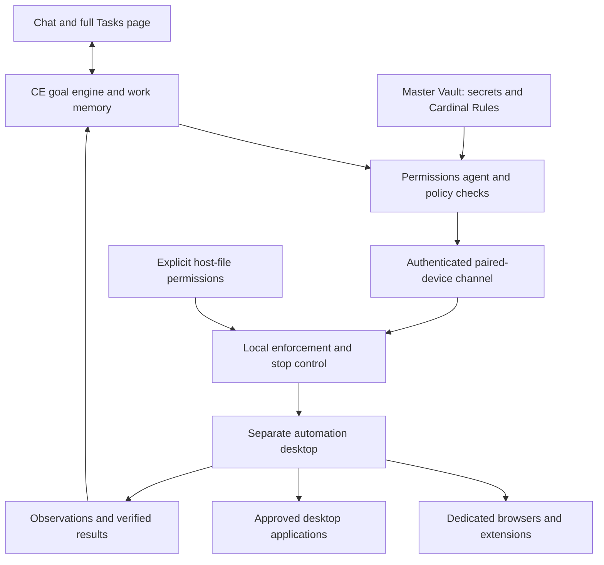

# Unified Josi app and autonomous work build plan

Accepted product direction: 19 October 2026. Status: **planning approved; implementation phases pending**.

Josi will ship as one macOS app that includes the server and the user interface, completes setup inside the app, and continues to support clients connected to a server on another computer. It will own work through a verified outcome or a specific request for further instructions. A compact live summary in chat and a full task-manager page will show the same work. Browser and computer automation will run in a separate automation desktop from the first release, governed by explicit permissions and vault-backed Cardinal Rules.

This plan consolidates the product decisions for the next build. It does not mark any new capability as shipped. It supersedes older requirements for an optional, separately installed macOS client and an external-browser setup walkthrough in the new unified release. Historical implementation and acceptance records remain evidence of their original versions. Existing release security, data-preservation, signing, and physical acceptance requirements remain applicable.

## Accepted scope

| ID | Requirement |
|---|---|
| U01 | One macOS application, one installer, in-app setup, and coordinated update, repair, and uninstall. The server installation always includes the client interface. |
| U02 | Preserve remote CE clients and existing server/client use across computers. The unified app offers **Run Josi on this Mac** or **Connect to an existing Josi**; the latter requires no running local server. |
| U03 | Build macOS first. Keep protocols and shared components portable for later Windows/Linux work; those native implementations are outside this build. |
| U04 | Remove OpenClaw and Hermes connections from the rebuilt client. Preserve Josi CE connectivity and users' CE data. |
| U05 | Support Chrome, Firefox, Safari, and Brave through extensions and browser-specific adapters. Control only dedicated Josi browser workspaces with their own storage and sign-ins. |
| U06 | Separate automation desktop in the first release, displayed in its own window. The proposed implementation is a Josi-managed macOS VM on Apple Silicon, subject to Phase 0 proof. Browser workspaces run inside it by default. |
| U07 | Add CE browser-control and computer-use tools. A server may control an authorized workspace on the same or another paired computer. Ordinary remote chat does not require automation support. |
| U08 | Full autonomy within explicit grants, Cardinal Rules, and approved limits. A permissions agent reviews context; deterministic controls enforce every supported operation. |
| U09 | Highly customizable server settings for users, devices, workspaces, apps, sites, files, data transmission, actions, grants, budgets, and activity retention. Device-owner consent is also required. |
| U10 | Cardinal Rules must be explicit, meaningful, testable restrictions supported by real controls. Reject vague or unsupported commandments. Make no absolute reliability promises. |
| U11 | **Test Rule** uses the selected connected LLM to assess meaning and clarity, plus deterministic enforcement tests. The LLM only advises the admin. Only the super admin can make a rule permanent, change it, or retire it. |
| U12 | The existing Master Vault is the sole authoritative store for secrets and Cardinal Rules, including drafts, reviews, active versions, and change history. No competing settings or memory authority. |
| U13 | Automatic current-work memory, durable checkpoints, and evidence-based learning from corrections and verified results. Users can inspect, correct, pin, and forget memories. |
| U14 | Own accepted goals end to end: continue within authority, verify completion, or return with a specific blocker and request for instructions. A failed attempt or completed reply does not finish the goal. |
| U15 | A compact, continuously updated progress card inside chat and a larger task-manager page share one authoritative task record. |
| U16 | Optional live viewing of the automation desktop, readable activity, direct steering, Pause, Take over, Resume, and Stop. |
| U17 | Preserve accounts, conversations, vault/recovery material, CE connections, files, and existing task state across migration. |
| U18 | Use phase-sized implementation and verification checkpoints. Astra is the intended planning/build model when selected by the operator; model settings and spending authority are not changed by this plan. |

## Existing foundation and gaps

The source baseline reviewed for planning is `a59529e` on `macos/native-distribution-20261009`. Recheck the current source and client provenance before implementation rather than treating this snapshot as an immutable upstream release.

| Area | Foundation to reuse | Work still required |
|---|---|---|
| macOS packaging | `packaging/macos`, `scripts/macos`, isolated services, journals, backup/recovery, readiness | Replace the separate server-management and optional client product flow; preserve lifecycle guarantees. |
| Client | Available desktop 0.6.5 source uses Electron and already displays CE in an app window | Verify source/version/provenance; bring the maintained CE client into the build; remove other backend paths; add startup/recovery and automation surfaces. |
| Setup | `apps/web/src/pages/Setup.tsx`, API setup state, one-use bootstrap handoff | Run the walkthrough in the app with a protected bootstrap exchange and recovery when the backend is unavailable. |
| Vault | `packages/core/src/vault.ts`, `masterKey.ts`, `apps/api/src/http/vaultRoutes.ts` | Add versioned rule records, current-rule authorization, and an inventory/migration of every secret consumer. Existing sealed data is not automatically proof of vault-only authority. |
| Permissions | `packages/core/src/pcControl.ts`, `apps/api/src/http/pcControlRoutes.ts`, `apps/web/src/pages/admin/PcControl.tsx` | Current routes are Windows-host/super-admin scoped, scopes include Windows paths, and the response reports no executor. Generalize identities and implement real local enforcement. |
| Tasks | `packages/core/src/tasks.ts`, `mobile.ts`, `actionState.ts`, `queue.ts`, `apps/worker/src/jobs.ts` | Separate goals from turns/attempts, persist steps and completion evidence, recover safely, and surface actionable blockers. Existing leases and duplicate-action protections must be preserved. |
| Agent | `packages/agent/src/assistantAgent.ts`, tool registry/executor, subscription MCP harness | The default six-hop turn limit can end with a generic rephrase request. Add durable continuation and escalation without turning it into an unbounded loop. |
| Task UI | `apps/web/src/pages/Tasks.tsx`, `lib/taskManager.ts`, `pages/Talk.tsx` | The manager polls at three seconds and mixes reply runs, background tasks, and reminders. Add one goal view, real step progress, live chat cards, and desktop watching. |

## Product and execution architecture

The unified app contains the CE interface, a startup/recovery shell, service management, and the local automation controller. Server services keep their restricted identities and independent lifecycle. Closing the interface leaves hosting services running; stopping the server is an explicit action. Chat remains usable while an automation desktop is stopped or being prepared.

The shared client belongs in the maintained source/build graph, with its source origin, licenses, and packaging pinned. Prefer an `apps/desktop` workspace after verifying the existing client's provenance. Keep privileged installation/maintenance in a narrow native helper; rendering a server page must not grant that page unrestricted native authority.



The VM proposal must prove guest provisioning, signed helper delivery, display/input, Accessibility and screen-capture permissions, browser extension enablement, controlled networking, and recovery. Use Apple-supported installation and user-consent flows. There must be no silent fallback to controlling the user's normal desktop. Apps and sign-ins live inside the guest. Host files enter or leave through explicit permissions; writable shared mounts are unsuitable for a policy that must independently restrict edits, deletion, or export.

Execution is local to the paired device that owns the selected workspace. Model inference may be local or remote according to the configured provider and data-transmission policy. A remote viewer must authenticate and own the task/device session; server administration alone does not authorize reading another user's desktop or task content. Use capability negotiation so existing clients can continue chatting without implementing new automation features.

One task holds control of a desktop at a time. Observation, proposed action, permission checks, dispatch, and result verification are distinct events. Bind actions to the actual device, workspace, app/tab/window, current policy version, and relevant observed state. Recheck after navigation, focus changes, human takeover, policy changes, and reconnection. Expired or replayed commands cannot dispatch. A disconnect stops new actions; recovery reconciles uncertain effects before retrying them.

## Vault and Cardinal Rules

### Authority and storage

Extend the existing Master Vault rather than introducing another secret store. Store rule wording, structured meaning, scope, version, lifecycle state, LLM review, test results, enforcement dependencies, and administrator changes there. Settings and memory use references. Application-owned API keys, OAuth tokens, pairing credentials, private keys, and persistent authentication material must have a documented vault authority and revocation path.

Phase 2 must inventory existing protected service files and OS credential storage before claiming compliance. Cryptographic bootstrap requires a root of trust capable of opening the vault; OS-protected wrapping keys are part of the vault's key hierarchy, not a second user-editable credential authority. Any unavoidable protected runtime projection must be vault-issued, minimized, versioned, revocable, and incapable of independently changing canonical values.

Browser authentication state also counts as secret data. Its persistent storage must be part of vault-managed encrypted workspace storage, with vault-controlled access, versioning, and revocation; confining an independently authoritative cookie/password store to a VM is insufficient. Runtime browser profiles may be projections of that managed state, never imported personal profiles. P0/P2 must prove the storage, crash recovery, and session-reset design before claiming compliance. If a browser requires a secret-storage exception, return that conflict to the owner instead of silently exempting it. Revoking local access does not itself invalidate a website's session; provider logout/revocation behavior must be recorded and handled separately.

A device must verify current vault authority before dispatch. Cached rules or memory cannot authorize disconnected execution. When the vault is locked, unavailable, corrupt, or its version cannot be verified, automation pauses. An encrypted backup is recovery material, not active authority; restore requires reconciliation so old backups cannot silently resurrect revoked grants. Logs record rule IDs/versions and decisions without secret values. Vault governance does not give the super admin general access to another user's private content.

### Explicit rule format

The settings page must say:

> Cardinal Rules must be explicit and enforceable. Specify exactly what is allowed or forbidden, where it applies, and any limits. Statements such as “do no harm” or “make good decisions” cannot be Cardinal Rules.

Every rule specifies an action, exact scope, restriction or measurable limit, enforcement mechanism, and behavior when required information is unavailable. Natural-language input is translated into a structured proposal for the admin to inspect. No guessed meaning becomes active. Examples include restricting host writes to selected folders, blocking a named execution tool, or forbidding new actions after a defined task duration. Examples in this document are not automatically installed rules.

Generic UI clicks do not prove their business effects. Spending limits, permitted recipients, field restrictions, and similar conditions require a supported adapter that can verify the relevant facts. If a rule cannot be enforced for an execution route, that route cannot perform the affected operation. A browser, clipboard, shell, script, native API, or alternate tool must not provide an unexamined route around a rule. OS and network boundaries are required where an app-level check alone cannot constrain the effect.

### Test Rule and permanent activation

1. The super admin writes a draft in the vault.
2. **Test Rule** sends a minimized, permitted representation to the currently selected connected LLM. It assesses meaning, ambiguity, missing conditions, conflicts, and loopholes, and explains suggested wording. It does not approve, activate, or silently rewrite the rule.
3. Deterministic validation checks supported enforcement mechanisms. Isolated simulations exercise allowed, denied, boundary, bypass, conflicting, and unavailable-check cases without real side effects.
4. Show **Ready for admin decision**, **Needs clarification**, **Unsupported**, or **Test failed**, with examples and a separate LLM assessment. A provider outage or unusable model response is reported; no fabricated review is shown.
5. For a supported rule with passing required checks, ask **Make this rule permanent?** Only a freshly authenticated super admin can confirm the exact reviewed version through the protected control interface. Automation credentials cannot perform that confirmation, including through UI control.
6. Permanent means active until the super admin explicitly changes or retires it. Edits create a new draft and require testing and confirmation again. Enforcement changes trigger revalidation. Failed revalidation pauses affected automation; it does not let Josi rewrite or retire the rule.

New dispatches use the latest active version. A policy change invalidates pending grants and queued actions as appropriate; it cannot undo already completed external effects. Cardinal Rules outrank task instructions, memories, learned habits, ordinary grants, and external page/document content. Explicit denial wins. Report supported controls and observed test results without promising perfect interpretation or flawless enforcement against every possible failure or machine administrator.

## Automation permissions

Provide **Server Settings → Automation & Permissions**, linked from the client. Start automation disabled until the device owner enrolls the device and grants access. Enabling a master switch alone grants no app/site/file access.

| Category | Required controls |
|---|---|
| Identity | User, server, paired device, automation workspace, browser profile, and task. |
| Browser | Exact sites/origins, navigation, viewing, filling, submission, downloads, uploads, and supported purchase operations. |
| Applications | App identity, launch, observation, interaction, close, installation, and removal as separate capabilities. |
| Files | Exact folders, explicit descendant behavior, read/create/edit/rename/move/delete, and host import/export. |
| Information | Screenshots, extracted text, clipboard, credential use, model/provider transmission, and recording. |
| Network | Allowed destinations, local-network access, and enforceable guest egress constraints. |
| Execution | Separate terminal, script, interpreter, system-setting, and administrative-operation controls. |
| Lifetime and limits | Task, expiration, standing exact-scope grants, schedule, duration, action/resource limits, and supported transaction budgets. |
| Visibility | Activity retention, optional screenshot retention, visible current activity, and per-device stop controls. |

Rule modes are **Deny**, **Ask**, **Allow for this task**, **Allow until a specified time**, and **Standing permission within an exact scope**. Show effective permissions, precedence, expiration, and a **Would this action be allowed?** preview. Supported preauthorized work proceeds without repeated prompts. Unmatched/uncertain operations follow the configured stop-or-ask behavior; they never inherit permission from a vague task request. Platform consent and provider-mandated human steps remain real boundaries.

The permissions agent reviews context and can flag uncertainty or narrow a proposed action. Deterministic policy checks and the local device gate hold execution authority. The existing blanket high-risk/generic-control prompts must be deliberately redesigned for supported autonomous scopes, with regression coverage. Do not just remove the current checks.

For the new release, U08/U09 supersede unconditional per-action prompting where a supported operation is covered by an explicit automation grant. This includes the legacy new-recipient, attachment, and delete prompts recorded in M43/M44 and the storage section's M47. The replacement must verify the exact permitted recipients/history exposure, file/destination effects, or deletion scope before dispatch. With no matching grant or no reliable verifier, existing ask/deny behavior remains. Admin mapping restrictions and device/user consent still apply; migration must not turn old one-time approvals into standing grants. Cardinal Rule administration, protected permission expansion, and platform/provider-required human steps cannot be preapproved by automation. P4 must publish an operation-by-operation mapping of old prompts to replacement enforcement and remaining human-only gates, consistent across tool routes.

## Current-work memory and learning

Maintain a durable, owner-scoped work record per goal: requested outcome, decisions and corrections, authorized scope, steps, verified results, failed approaches, blockers, relevant artifact references, and next action. Update after meaningful events and before yielding or handing off. Load the relevant current state when resuming or choosing the next action; a summarized model context must not erase the durable record.

Distinguish user instructions, observed facts, preferences, and unverified assumptions. Reconcile stale claims and contradictions against fresh evidence. Learn reusable habits from explicit corrections and verified outcomes, with provenance and scope. Learning cannot alter rules, expand grants, install tools, or change program code. Memory must reference vault secrets/rules without duplicating authoritative values. Treat page text, screenshots, documents, and tool output as untrusted evidence that cannot create permissions.

Provide **What Josi remembers** with inspect, correct, pin, and forget. Keep sensitive unrelated content out of routine task summaries. Define retention, deletion propagation, encrypted backups, and the distinction between editable memory and required audit records. A quiet **Saved progress** indicator confirms a durable save. Task checkpoints synchronize across authenticated clients without exposing one user's work to another.

## Goal ownership and live task experience

### Completion and continuation

A goal is the requested outcome. A step is a bounded part of that outcome. Attempts, model turns, tool calls, and background jobs belong to the goal and do not independently establish its completion. Define completion criteria at acceptance using the information already supplied; ask only when missing information changes the outcome or authority.

Every accepted goal remains accounted for until the outcome is verified, the user cancels it, or Josi presents a specific decision needed to proceed. Physical/legal impossibility, unavailable capabilities, permission denials, and exhausted approved limits require a clear explanation and next choice rather than silent abandonment or policy bypass. A failed attempt alone does not move an unfinished goal to completed History. Give unresolved work a visible attention state.

Save checkpoints and a next action, scheduled wake, external-event wait, or precise question. Retry recoverable failures with bounded backoff, try justified alternatives, and continue independently unblocked steps. Detect repeated unproductive attempts and stale “Working” states. Preserve existing duplicate-effect protection: after uncertain writes, inspect the destination before deciding whether retry is safe. Time/cost limits checkpoint and escalate; they do not trigger infinite continuation or a false completion.

Completion includes suitable evidence such as a saved artifact, destination record, published URL, or verified external state. “Queued to sync” remains distinct from “verified at the destination.” Task memory keeps the last reliable state. User steering updates the goal/plan revision and invalidates stale queued actions while preserving completed work and previously authorized scope.

### Chat and the full Tasks page

Use one durable goal/event record to drive both interfaces. Show one compact card per active goal in chat, updating in place rather than flooding the conversation with status messages. The larger page provides Active, Needs you/Waiting, Scheduled, and History views, expandable steps, readable activity, evidence, next action, task controls, and a link back to the conversation.

Illustrative chat card, not an actual task to execute:

```text
Publish missing listings — 1/3 complete
✓ Build catalog from storefront data
→ Check existing listings for duplicates — 42 of 60 checked
○ Publish missing listings and verify them

Now: Checking the next batch of listings.
Watch live · Details · Pause · Stop
```

Counts and states come from execution events and verified outcomes. Do not invent percentages, completion counts, ETA, activity, or evidence. Explain material plan changes. Separate Needs your answer, Waiting on a service, Scheduled to resume, and Paused by you; show the reason and next retry/wake when known. Show last meaningful progress and connection freshness rather than a permanent spinner.

Provide **Milestones**, **Detailed activity**, and **Watch live** viewing levels. Completion, material blockers, and requests for user input always surface; unchanged background state stays quiet. Activity explains actions and results, not hidden model reasoning or raw secrets. The screenshot's checklist is a UI reference, not a request to restore OpenClaw support. Where chat channels support message edits, update a single status message; otherwise send bounded milestone updates from the same event record.

Live viewing shows only the authorized automation desktop, with protected-content handling and separate permission for screen transmission/recording. Remote viewing and takeover require their own capability check. Pause, Take over, Resume, and Stop cancel or invalidate queued input appropriately. Closing a viewer must not implicitly cancel work. After takeover, Josi re-observes before resuming. Stop prevents further dispatch and revokes the execution grant; it does not claim to reverse completed changes.

## Build phases and acceptance gates

All phases below are **pending**. The default order is sequential; dependencies identify what must be proven before a later phase can enable execution. Each phase ends with a focused commit, applicable tests, evidence, and an updated status. A feasibility failure produces a concrete decision request; it does not silently remove an accepted requirement.

| Phase | Deliverable | Dependencies |
|---|---|---|
| P0 | Baseline inventory and feasibility proofs | This plan |
| P1 | Shared contracts, client source, and compatibility | P0 |
| P2 | Vault authority and migration | P1 |
| P3 | Cardinal Rules and Test Rule | P2 |
| P4 | Permission settings and paired-device enforcement | P1–P3 |
| P5 | Unified macOS app and in-app setup | P1–P4 |
| P6 | Separate automation desktop | P0, P2, P4, P5 |
| P7 | Four-browser extension control | P3, P4, P6 |
| P8 | Local computer-use engine | P3, P4, P6 |
| P9 | Durable goal ownership and recovery | P1–P4; integration with P7/P8 |
| P10 | Current-work memory and learning | P2, P3, P9 |
| P11 | Live chat summary, Tasks page, and watching | P7–P10 |
| P12 | Migration, end-to-end acceptance, and distribution | All preceding gates |

### P0 Baseline and feasibility

Inventory the actual server/client sources, vault consumers, task executors, existing mobile/desktop protocols, supported OS/hardware, and build/signing inputs. Catalogue legacy mandatory approvals and their underlying effects for the P4 replacement mapping. Prove macOS VM installation, guest control and display, consent, networking isolation, host-file containment, restart/recovery, and the four browsers' dedicated-workspace behavior. Verify Safari packaging/native messaging and Firefox interaction coverage independently of Chromium. Measure resource costs and identify supported minimums; do not publish guessed capacity numbers. Establish browser/desktop action matrices, extension distribution requirements, and model capability needs. Record actual platform/licensing/distribution constraints from current primary documentation.

**Gate:** executable disposable proofs and a capability/limitation matrix cover the required isolation and control paths. Identify non-automatable setup steps and resolve any requirement-changing blocker with the owner before dependent implementation. No personal browser or production data is used for probes.

### P1 Contracts and source consolidation

Pin the client source and integrate its CE-facing code/build with provenance. Define versioned contracts for goal/step/attempt/event, device/workspace identity, observations/actions, control ownership, vault/rule references, permission verdicts, and recovery. Remove OpenClaw/Hermes choices and transports from the new client. Keep current CE endpoints compatible or supply explicit version negotiation and migration.

**Gate:** contract tests cover existing remote clients, capability negotiation, owner isolation, unsupported operations, reconnect, and a CE-only client. Old clients can continue ordinary work while new features are unavailable to them.

### P2 Vault authority

Add canonical record types and versions for Cardinal Rules and enforcement metadata. Inventory and migrate application secrets/consumers to vault references; specify root-of-trust, browser-session, service bootstrap, and short-lived execution-credential handling. Implement authenticated current-version checks, lock/revocation behavior, backup/recovery reconciliation, and redacted auditing. Do not replace encryption/recovery material just to simplify migration.

**Gate:** alternate persistent settings cannot become authority; vault outage/lock blocks new automation; remote revocation and recovery work; no plaintext values reach logs/memory/model context; existing secrets and recovery access survive migration.

### P3 Cardinal Rules

Implement the supported rule schema, editor, connected-LLM meaning review, deterministic validator/simulator, result explanations, and super-admin permanent activation. Pin review/test results to exact content and enforcement versions. Protect activation from automation credentials, stale tabs, concurrent edits, replay, and older restored versions. Revalidation failure pauses affected execution without changing the active rule.

**Gate:** vague/unsupported rules cannot activate; the LLM cannot approve; ordinary users and automation cannot mutate rules; super-admin confirmation applies only to the reviewed version; allowed/denied/boundary/conflict/bypass tests and vault-only persistence pass.

### P4 Permissions and device bridge

Replace Windows-host-only scope assumptions with verified device/workspace identities. Build the detailed settings, effective-permission preview, grants/expiry/budgets, contextual permissions review, and local dispatch gate. Enroll devices with owner consent; use authenticated outbound connectivity appropriate for local and remote servers. Provide local emergency stop and one-controller ownership. Apply the same enforcement to direct tools, subscription MCP routes, and fallback control paths. Publish and test the legacy-approval replacement mapping: supported scoped grants remove redundant prompts, while unsupported operations and human-only gates remain blocked or ask as specified. Existing grants must not widen during migration.

**Gate:** cross-user/device attempts, stale grants, replay, unknown targets, changed focus, vault loss, channel interruption, and alternate-route bypass are denied. Supported standing/task grants permit autonomous work without redundant prompts. A remote server cannot grant itself access to a device.

### P5 Unified macOS application

Deliver one visible app and installer. Add Run locally/Connect remotely, embedded setup, service health, diagnostics, backups, maintenance, and a startup/recovery shell that remains usable when CE is down. Preserve one-use bootstrap semantics without launching an external setup page. External identity-provider authentication may still open its required sign-in flow. Coordinate app/server/helper versions and retire the optional-client component choice.

**Gate:** fresh host setup, remote-only use, interrupted setup/resume, backend failure, app closure, server stop/start, reboot, and CE connection migration pass. One installation does not create a second owner, vault, or conflicting service set.

### P6 Isolated automation desktop

Implement the validated VM lifecycle and signed host/guest components inside the one-product experience. Provision a persistent user-scoped workspace, guest apps/sign-ins, controlled file exchange, network restrictions, authenticated guest channel, and a separate view window. Expose measured storage/memory requirements, repair/reset controls, and recovery semantics. Never equate reverting local state with undoing external side effects.

**Gate:** automated actions remain inside the guest; host filesystem, clipboard, network, and credentials are reachable only through explicit grants. OS consent works through supported flows. Suspend/restart/crash/reset, lock, device disconnect, and recovery do not replay uncertain actions or expose another user's workspace.

### P7 Browser extensions

Build shared browser contracts and page-interaction code with a Chromium adapter for Chrome/Brave, a Firefox adapter, and Safari native-extension packaging. Implement workspace discovery, navigation, observations, element actions, forms, controlled file transfers, status, and handoff. Verify permissions on redirects, popups, frames, navigation, restricted pages, and session reconnection. Report unsupported operations honestly. Install/enable extensions through supported browser flows.

**Gate:** each of the four browsers passes the agreed scenario matrix in a dedicated workspace. Personal profiles cannot be selected. Local and remote CE sessions, user takeover, and secret/session boundaries pass. API differences are documented rather than hidden behind a false parity claim.

### P8 Computer-use engine

Implement guest Accessibility observations/actions and the verified screenshot/input fallback, with state/coordinate validation and result checks. Add CE computer tools, app identity binding, file dialogs, clipboard controls, and human handoff. Prefer supported structured actions when they allow stronger verification. Expose only model-compatible operations; a model choice does not grant authority.

**Gate:** representative guest applications complete observed workflows; target changes and uncertain consequential actions stop safely. Desktop input cannot bypass browser, file, network, terminal, or rule-administration restrictions. Only permitted screen content reaches the configured model or viewer.

### P9 Goal ownership

Persist outcome criteria, plan revisions, steps/dependencies, attempts, checkpoints, evidence, next action/wake, and precise questions. Link turns and jobs to goals. Add continuation, bounded recovery, external waits, stalled-task detection, cancellation, and user steering. Reconcile destination state after uncertain side effects. Keep blocked work visible and preserve unblocked progress.

**Gate:** a completed reply/failed attempt cannot falsely complete a goal; every unfinished goal has a recorded next action, wait, or question; app/server restarts and context rollover preserve work. Loop/budget exhaustion requests a concrete decision. Verified completion, duplicate-effect avoidance, and permission rechecks pass.

### P10 Work memory and learning

Implement automatic checkpoint summaries, selective retrieval, durable correction handling, provenance, fact/preference/assumption distinctions, and reusable evidence-based lessons. Add the memory viewer with correction/pinning/forgetting and saved-progress feedback. Keep vault references and task evidence boundaries intact.

**Gate:** cross-device resume preserves decisions and progress; stale/conflicting facts are reconciled; external content cannot become an instruction or grant; forgetting/retention behavior is tested; no learned behavior modifies Cardinal Rules or permissions.

### P11 Chat progress and full task manager

Publish authorized task events with resumable delivery and compatibility fallbacks. Build updating chat cards and the full Tasks page from the same durable projection. Include real checklist counts, current activity, blockers, next wake, evidence, steer/pause/stop controls, detail levels, and owner-only live viewing/takeover. Keep channel notifications useful and bounded.

**Gate:** reconnect/multiple clients show the same goal revision without duplicate cards or events; reply completion never appears as goal completion. Progress uses real receipts, stale activity is visible, and completion/blocker notices reach the appropriate user. Privacy, keyboard/mobile layout, and takeover-before-resume behavior pass.

### P12 Migration and release acceptance

Test server-only, client-only, combined, and remote-client installations; preserve data and upgrade/rollback evidence. Cover vault/rule/key migration, client protocol compatibility, interrupted installation, reboot, service shutdown, VM recovery, provider outage, offline devices, prompt-injection attempts, and rule changes during work. Verify an end-to-end goal spanning browser and desktop actions, memory/resume, chat updates, task-manager evidence, and human handoff.

**Gate:** required scenarios pass on real supported hardware with exact versions and artifacts recorded. Complete relevant tests, type/build checks, public-data scan, licenses/source closure, signing/notarization, and physical clean-install/upgrade acceptance. Document real remaining limitations. Git commits and test builds do not themselves authorize publishing a release or installing onto a live machine.

## Build operating rules

- Keep status and evidence beside each phase; do not mark completion from a model statement alone. Record commit, checks, results, remaining limits, and the next phase.
- Use Astra for planning/build work when selected by the operator. Phase checkpoints and measurable progress govern continuation; available credits do not authorize unbounded spending or loops. No credit balance or account credentials belong in source control.
- Preserve historical artifacts, failed-run evidence, databases, keys, and recovery copies. Use disposable environments for fault injection and acceptance preparation.
- Run relevant checks and the repository's public-data scanner for each change. Plan-only commits require document/link/traceability review and scanning, not unrelated runtime builds.
- Use the available Ruflo route/memory tools when required by workspace instructions. If unavailable, record that limitation and use the committed plan and phase evidence; do not claim a swarm or memory operation ran.
- No implementation, installation, signing, VM provisioning, or release publication is authorized by this documentation commit. The next build instruction begins P0.

## Reference points for feasibility work

- [Apple macOS virtualization](https://developer.apple.com/documentation/virtualization/virtualize-macos-on-a-mac) and [shared directories](https://developer.apple.com/documentation/virtualization/shared-directories).
- [Apple Accessibility](https://developer.apple.com/documentation/applicationservices/axuielement) and [ScreenCaptureKit](https://developer.apple.com/documentation/screencapturekit).
- [Chrome native messaging](https://developer.chrome.com/docs/extensions/develop/concepts/native-messaging) and [debugger transport](https://developer.chrome.com/docs/extensions/reference/api/debugger).
- [Firefox native messaging](https://developer.mozilla.org/en-US/docs/Mozilla/Add-ons/WebExtensions/Native_messaging) and [Chrome incompatibilities](https://developer.mozilla.org/en-US/docs/Mozilla/Add-ons/WebExtensions/Chrome_incompatibilities).
- [Safari native messaging](https://developer.apple.com/documentation/safariservices/messaging-between-the-app-and-javascript-in-a-safari-web-extension) and [distribution](https://developer.apple.com/documentation/safariservices/distributing-your-safari-web-extension).
- [Brave extension support](https://support.brave.com/hc/en-us/articles/360017909112-How-can-I-add-extensions-to-Brave).
- [OpenAI computer-use integration](https://developers.openai.com/api/docs/guides/tools-computer-use). This is a public integration reference, not a claim that Josi has access to or reproduces proprietary desktop internals.

Reverify platform/API requirements during P0 and release preparation; this plan does not freeze third-party behavior.
